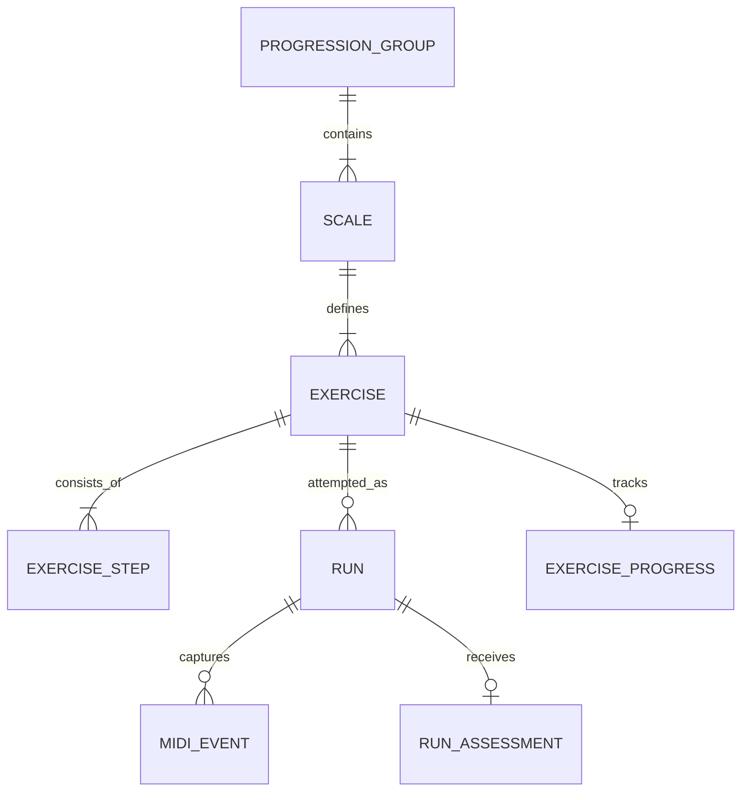

# Piano Scale Trainer Architecture

## Status and authority

This is the technical reference for building v1. It replaces the candidate data model documents as implementation guidance. `SPEC.md` remains the product and scope authority; this document makes its implementation choices explicit.

The project is a single-user, single-process application. It deliberately has no distributed-system components, background workers, cache, event bus, or generic architecture layers.

## Architectural decisions

### Stack

- Language: TypeScript in strict mode, in both browser and server.
- Runtime: the active Node.js LTS release when implementation starts, pinned in `.node-version`, the `package.json` engine declaration, CI, and the dependency lockfile where applicable.
- Browser UI: React built by Vite.
- HTTP server: Fastify.
- Runtime request validation: TypeBox schemas registered with Fastify.
- Database: SQLite, accessed through `better-sqlite3`.
- Migrations: hand-written SQL, committed and reviewed before use.
- Tests: Vitest for domain, client, database, and HTTP integration tests.
- Deployment: one Node.js deployable containing the Fastify server and the compiled browser assets, with one SQLite database file on persistent storage.

Fastify serves `/api/*` and the compiled SPA from the same process and origin. There is no separate frontend deployment and no CORS configuration.

The deployment runs pending migrations before starting the HTTP listener. A migration failure prevents startup. Catalog seeding is an explicit setup step, not an automatic startup side effect.

### Why this stack

TypeScript is used end to end so the project can focus on the intended learning goals: persistence, migrations, domain tests, and CI. Introducing a second language would add learning surface without improving the product.

SQLite is chosen over PostgreSQL because there is one user, one server process, no availability requirement, and no concurrent write workload. It still provides transactions, foreign keys, check constraints, indexes, and real migrations. PostgreSQL was rejected because a separate database service and its operations would solve scale and concurrency problems this project does not have. The application must run as one process; multiple replicas sharing the SQLite file are unsupported.

Fastify is chosen over Next.js because the application needs an explicit JSON API and a static client, not server rendering or framework-owned persistence boundaries. Fastify also supports runtime JSON-schema validation and in-process HTTP tests. Express was rejected because equivalent validation and typing would need more assembly.

Raw SQL through `better-sqlite3` is used because the queries are few and simple, while the schema itself — constraints, check rules, and migrations — is the project's learning goal. Hand-written SQL migrations keep every constraint and migration decision directly visible and reviewable, with no ORM layer between the code and the schema. An ORM (Prisma and Drizzle were both considered) was rejected because it would add mapping machinery without teaching more about migrations, and a parallel TypeScript schema definition would drift from the real migration SQL and mislead readers about the source of truth.

React and Vite are used because MIDI capture, the metronome, and practice-state rendering are browser responsibilities. Next.js and SSR were rejected because the initial page contains no server-rendering requirement.

There is no WebSocket. A run is scored after its fixed capture window, so one HTTP request is simpler than streaming events to the server.

There are no application user accounts. V1 assumes local or privately restricted deployment. If it is exposed publicly, access control belongs at the hosting boundary. An in-application auth model was rejected because the specification has one user and no account-management requirement.

## Runtime shape

The browser owns real-time work:

- requesting Web MIDI permission
- selecting a MIDI input
- scheduling the count-in and metronome clicks
- recording MIDI messages against a monotonic browser clock
- displaying the active exercise
- sending one completed run

The server owns durable and authoritative work:

- validating request shape
- loading the seeded exercise definition
- scoring the raw run
- storing the run, events, original assessment, and progress update atomically
- serving history and lazily calculated current assessments
- rebuilding progression snapshots

The database is not accessed from the browser. The browser does not decide faults, pass/fail, or progression.

## Configuration and deferred decisions

Configuration is loaded once at server startup and validated. Startup fails with a specific error when a required value is absent or invalid. The repository may provide an example configuration, but it must not provide pretend production defaults for unresolved values.

The following remain configuration, with no value selected by this document:

- initial tempo
- tempo increment
- tempo decrement, if the selected failed-run behavior requires one
- minimum tempo, if the selected failed-run behavior steps tempo down
- timing deviation tolerance
- overlap tolerance
- maximum timing and overlap faults allowed for a clean run
- number of matched notes excluded from timing after a hard fault
- failed-run behavior: reset the streak or step the tempo down
- fingering dataset path, source name, source URL, and dataset version

The rule requiring three consecutive clean runs is decided in `SPEC.md`; it is not an unresolved threshold. The actual soft-fault tolerances and gates are unresolved.

Every original assessment stores the scoring and progression configuration used for it. The snapshots use canonical JSON objects so later code can explain the historical decision.

The progression configuration supports the two explicitly deferred behaviors without selecting one:

- `reset_streak`: keep the current tempo and set the streak to zero.
- `step_down`: subtract the configured decrement, stop at the configured minimum tempo, and set the streak to zero.

There is no default behavior. Supporting these two small branches is intentional because runtime configuration was requested; a generic policy plugin system was rejected.

When `step_down` is selected, configuration validation requires the minimum tempo not to exceed the seeded initial tempo or any existing exercise's current tempo. Applying the policy clamps at that minimum, so a failed run can never increase tempo.

Scoring and progression algorithm versions are code constants, not operator configuration. Changing behavior requires changing the version.

The latest project decision explicitly keeps the fingering source unresolved, despite the conflicting earlier source-of-record sentence in `SPEC.md`. The fingerings already stated explicitly for Group 1 and F, plus the stated starting fingers for B-flat, E-flat, and D-flat, remain domain constraints. For each one-octave exercise, descending fingering is the ascending sequence in reverse. Agents may not invent the remaining black-key fingerings or their provenance. The application cannot seed a runnable catalog until the complete dataset and its provenance have been supplied.

Velocity is captured but ignored by v1 scoring. Extra-note debounce is not implemented in v1; every duplicate or adjacent note remains a hard fault until the deferred decision is revisited.

## Database

### SQLite conventions

- Table and column names use `snake_case`; application properties use `camelCase` at the boundary only.
- Primary keys are SQLite `INTEGER PRIMARY KEY` values.
- Wall-clock timestamps are integer Unix milliseconds in UTC.
- Run-relative timing uses signed integer microseconds.
- Booleans are `INTEGER` values constrained to `0` or `1` and mapped to TypeScript booleans in application code.
- Enum-like values are `TEXT` columns with check constraints.
- Configuration snapshots are canonical JSON stored as `TEXT` with `json_valid(...)` and `json_type(...) = 'object'` checks. Their internal shape is validated by the application.
- Foreign-key enforcement is enabled on every connection with `PRAGMA foreign_keys = ON`.
- Production code exposes no update or delete operation for runs, MIDI events, or original assessments.

Microseconds exceed human timing needs but preserve the browser's timestamp without premature rounding. SQLite integers and JavaScript numbers safely hold these short run offsets.

### Relationship diagram



### `progression_groups`

| Column | SQLite type | Rules |
| --- | --- | --- |
| `id` | `INTEGER` | Primary key |
| `slug` | `TEXT` | Not null, unique, stable machine identifier |
| `name` | `TEXT` | Not null, unique |
| `progression_order` | `INTEGER` | Not null, unique, check greater than zero |

The database enforces unique identities and ordering positions. The seed validator enforces that the three specification-defined groups exist and have the intended order.

### `scales`

| Column | SQLite type | Rules |
| --- | --- | --- |
| `id` | `INTEGER` | Primary key |
| `progression_group_id` | `INTEGER` | Not null, foreign key to `progression_groups.id`, delete restricted |
| `slug` | `TEXT` | Not null, unique, stable machine identifier |
| `display_name` | `TEXT` | Not null, unique |
| `tonic_pitch_class` | `INTEGER` | Not null, unique, check from 0 through 11 |
| `position_in_group` | `INTEGER` | Not null, check greater than zero |

There is a unique constraint on `(progression_group_id, position_in_group)`.

`tonic_pitch_class` is numeric MIDI identity; scoring never parses `display_name`. F-sharp/G-flat is one row with one pitch class and one display name. The application seed validator enforces the exact twelve physical scales and their group membership.

### `exercises`

| Column | SQLite type | Rules |
| --- | --- | --- |
| `id` | `INTEGER` | Primary key |
| `scale_id` | `INTEGER` | Not null, foreign key to `scales.id`, delete restricted |
| `direction` | `TEXT` | Not null, check in `ascending`, `descending` |

There is a unique constraint on `(scale_id, direction)`.

Hand, octave count, and rhythmic subdivision are not columns. V1 has one right hand, one octave, and one note per beat. Adding speculative dimensions would permit invalid combinations that the product cannot perform. A future scope change adds columns and a real migration.

The seed validator enforces exactly two exercises per scale and therefore 24 exercises in total.

### `exercise_steps`

| Column | SQLite type | Rules |
| --- | --- | --- |
| `id` | `INTEGER` | Primary key |
| `exercise_id` | `INTEGER` | Not null, foreign key to `exercises.id`, delete cascades |
| `step_index` | `INTEGER` | Not null, check from 0 through 7 |
| `note_spelling` | `TEXT` | Not null, check non-empty |
| `semitone_offset` | `INTEGER` | Not null, check from -12 through 12 |
| `finger_number` | `INTEGER` | Not null, check from 1 through 5 |

There is a unique constraint on `(exercise_id, step_index)`.

The database can constrain individual rows but cannot enforce exactly eight rows, contiguous indexes, a zero first offset, the correct signed endpoint, or musically valid note spellings without triggers. Triggers were rejected as hidden domain logic. The seed validator enforces:

- exactly eight steps indexed 0 through 7
- step 0 offset equals 0
- ascending step 7 offset equals 12
- descending step 7 offset equals -12
- offsets are strictly increasing for ascending and strictly decreasing for descending
- each displayed note and finger belongs to the configured catalog dataset

### `runs`

| Column | SQLite type | Rules |
| --- | --- | --- |
| `id` | `INTEGER` | Primary key |
| `exercise_id` | `INTEGER` | Not null, foreign key to `exercises.id`, delete restricted |
| `performed_at_ms` | `INTEGER` | Not null, check non-negative |
| `tempo_bpm` | `INTEGER` | Not null, check greater than zero |

`performed_at_ms` is the browser's wall-clock estimate for the first expected beat, not the HTTP receipt time. It exists for history ordering; timing analysis uses event offsets.

There is an index on `(exercise_id, performed_at_ms DESC, id DESC)` for exercise history. Progression replay uses server-assigned run IDs, not this wall-clock index.

Only completed runs are persisted. There is no capture status. The browser holds an attempt until its capture window ends. Losing an interrupted attempt is acceptable and avoids a partial-run lifecycle.

### `midi_events`

| Column | SQLite type | Rules |
| --- | --- | --- |
| `id` | `INTEGER` | Primary key |
| `run_id` | `INTEGER` | Not null, foreign key to `runs.id`, delete cascades |
| `sequence_number` | `INTEGER` | Not null, check non-negative |
| `offset_us` | `INTEGER` | Not null, signed |
| `event_type` | `TEXT` | Not null, check in `note_on`, `note_off` |
| `midi_pitch` | `INTEGER` | Not null, check from 0 through 127 |
| `velocity` | `INTEGER` | Not null, check from 0 through 127 |

There is a unique constraint on `(run_id, sequence_number)`. That constraint is also the event-loading index.

`offset_us` is relative to the first expected beat and may be negative for notes played during the count-in. Sequence number, not timestamp, breaks ties.

The browser normalizes MIDI note-on messages with velocity zero into `note_off`. The server validates that the transmitted events are already in the normalized two-event vocabulary.

### `run_assessments`

| Column | SQLite type | Rules |
| --- | --- | --- |
| `run_id` | `INTEGER` | Primary key and foreign key to `runs.id`, delete cascades |
| `algorithm_version` | `TEXT` | Not null, check non-empty |
| `scoring_parameters` | `TEXT` | Not null, valid JSON object checked with `json_valid` and `json_type` |
| `progression_policy_version` | `TEXT` | Not null, check non-empty |
| `progression_parameters` | `TEXT` | Not null, valid JSON object checked with `json_valid` and `json_type` |
| `hard_fault_count` | `INTEGER` | Not null, check non-negative |
| `timing_fault_count` | `INTEGER` | Not null, check non-negative |
| `overlap_fault_count` | `INTEGER` | Not null, check non-negative |
| `timing_sample_count` | `INTEGER` | Not null, check non-negative |
| `timing_excluded_count` | `INTEGER` | Not null, check non-negative |
| `mean_absolute_timing_deviation_us` | `INTEGER` | Nullable, otherwise check non-negative |
| `timing_start_offset_us` | `INTEGER` | Nullable fitted intercept in microseconds; reported, never a fault on its own |
| `passed` | `INTEGER` | Not null, check in 0, 1 |
| `assessed_at_ms` | `INTEGER` | Not null, check non-negative |

Using `run_id` as both primary and foreign key enforces at most one stored original assessment per run without a redundant assessment identity. The submission transaction enforces that every persisted run gets one.

Cross-column checks enforce:

- `timing_fault_count <= timing_sample_count`
- `timing_sample_count + timing_excluded_count <= 8`
- `mean_absolute_timing_deviation_us` is null exactly when `timing_sample_count` is zero

Only the original aggregate result is persisted. Per-step matching remains derived analysis rather than storage. The current detailed assessment is calculated from raw events when requested.

A JSON-only assessment result was rejected because the aggregate fields are stable query targets and deserve database checks. Separate per-step result rows were rejected for v1 because they duplicate derivable data before a query or performance need exists.

### `exercise_progress`

| Column | SQLite type | Rules |
| --- | --- | --- |
| `exercise_id` | `INTEGER` | Primary key and foreign key to `exercises.id`, delete cascades |
| `initial_tempo_bpm` | `INTEGER` | Not null, check greater than zero, immutable after seed |
| `current_tempo_bpm` | `INTEGER` | Not null, check greater than zero |
| `consecutive_clean_runs` | `INTEGER` | Not null, check non-negative |

There is exactly one snapshot row per seeded exercise. Ascending and descending therefore progress independently.

`initial_tempo_bpm` is the immutable genesis value needed for deterministic rebuilds. The other two fields are derived state. The application updates them in the same transaction that inserts the run and original assessment. It must also provide a rebuild command that resets an exercise to its persisted initial tempo and zero streak, then replays original assessments in `run_id` order using each assessment's stored progression policy version and parameters.

Replay uses `run_id`, not the browser's wall clock. Submission order is the order in which progression was originally applied; client clocks and delayed submissions must not reorder history.

Every progression-policy version found in stored assessments must retain a registered replay handler in `src/domain/progression` indefinitely. Original assessments are immutable and must not be rewritten merely to remove an old handler. A version string without executable semantics is insufficient for rebuilding.

The progression group order controls recommended presentation, not database locking. V1 has no defensible definition of a mastered tempo, so there is no unlock table and no hidden rule that prevents choosing another exercise.

### Database-enforced rules

SQLite enforces:

- primary-key identity
- all foreign-key relationships
- one exercise per scale and direction
- one step per exercise and index
- one MIDI event per run and sequence number
- at most one original assessment and progress snapshot per owner
- unique catalog slugs and progression positions
- scalar ranges for pitch, velocity, finger, index, tempo, counts, and booleans
- allowed direction and event-type values
- valid JSON syntax for parameter snapshots

### Application-enforced rules

The application enforces:

- exact catalog membership and 3/12/24/8 row counts
- musical consistency of tonic pitch classes, offsets, note spellings, and fingering
- immutable catalog definitions after runs reference them
- contiguous event sequence numbers beginning at zero
- atomic persistence of run, events, assessment, and progress
- exactly one original assessment for every persisted run and one progress row for every seeded exercise
- submitted tempo equals the exercise's authoritative current tempo
- no mutation or deletion of historical raw events and original assessments
- octave anchoring, event-to-step matching, faults, recovery exclusion, timing, overlap, pass/fail, and progression
- canonical shape and meaning of JSON parameter snapshots
- equality between `exercise_progress` and a rebuild from original assessments

Triggers were rejected for application-enforced musical rules because they would split domain behavior between TypeScript and hidden database programs.

## Migrations and seed data

### Initial migration

`0001_initial` creates all eight accepted tables, their foreign keys, unique and check constraints, and the exercise-history index. It contains no scale, fingering, exercise, or initial-progress rows.

The initial migration includes every column already known in this document. Known columns must not be artificially withheld merely to manufacture a later `ALTER TABLE` example.

Future schema changes are written as a new hand-written SQL migration, reviewed directly, and tested both from an empty database and from the preceding schema. Migrations are tracked and applied exactly once each by `src/server/db/apply-migrations.ts`; committed migration files are the record.

The portfolio acceptance criteria still require at least one genuine later migration that alters an existing table. That migration must come from an actual requirement discovered while using the application. Fabricating a meaningless two-step initial schema was rejected because it teaches the wrong migration practice. SQLite may implement some alterations by rebuilding a table; the migration SQL still must be reviewed and data-preservation tested.

### Seed data

A separate idempotent seed command inserts, in one transaction:

- progression groups
- twelve physical scales
- ascending and descending exercises
- eight steps for each exercise
- one initial progress row per exercise, using the configured initial tempo

Schema migrations create structure; seeds create domain catalog data. Keeping catalog data out of migrations is important because the fingering dataset and its provenance are unresolved configuration, not schema.

The seed input is a version-controlled data file selected by configuration. It contains provenance metadata and is validated before any row is inserted. The seed command inserts missing data and verifies matching existing data; it does not silently update definitions.

For a new exercise, the seed command writes both initial and current tempo from the configured initial tempo. For an existing progress row, a different configured initial tempo is a seed error; neither initial nor current tempo is changed. Application updates may change only current tempo and streak. There is no normal code path that updates `initial_tempo_bpm`.

Once any run references an exercise, its scale and steps are immutable. A later catalog correction must first introduce a versioned-exercise schema and create a new definition; even an explicit data migration must not update a referenced definition in place. Re-running a seed must never reinterpret historical runs.

## Browser MIDI capture

### Supported environment

V1 targets a desktop Chromium-family browser with Web MIDI support. Web MIDI is not available in every browser and requires a secure context and explicit user permission. Localhost is acceptable for development; hosted use requires HTTPS.

The user initiates `navigator.requestMIDIAccess({ sysex: false })`, which disables System Exclusive message access, then selects one connected MIDI input. Broad browser polyfills and raw system MIDI access were rejected because this is a one-user browser tool.

### Clock and capture window

The browser schedules the metronome with Web Audio while measuring MIDI against the DOM high-resolution time origin used by `performance.now()` and `MIDIMessageEvent.timeStamp`. When scheduling begins, it samples `performance.now()` and `AudioContext.currentTime` together. It converts the scheduled first-beat audio time through that sampled pair into a `DOMHighResTimeStamp` before the four-beat count-in begins.

Capture starts at the beginning of the count-in and ends one beat after the eighth expected note. This fixed tail permits the final note-off to be retained. Notes during the count-in are stored with negative offsets and are eligible to be scored as early extra notes.

A manual Stop button was rejected as the normal completion rule because missed notes make note-count completion unreliable, while manual timing would make runs inconsistent. An explicit Cancel action may discard the browser-local attempt without sending it.

For every Web MIDI `MIDIMessageEvent`, the browser:

1. Reads the status and data bytes.
2. Retains only note-on and note-off channel messages.
3. Converts note-on with velocity zero to note-off.
4. Assigns the next sequence number in callback order.
5. Computes `offsetUs = round((event.timeStamp - firstBeatTime) * 1000)`.

The converted first-beat timestamp and `MIDIMessageEvent.timeStamp` share the DOM performance time origin. `AudioContext.currentTime` must not be subtracted directly from a MIDI event timestamp. Wall-clock history time is calculated as `Math.round(performance.timeOrigin + firstBeatTime)` and sent as `firstExpectedBeatAtMs`; submission time is not a substitute. Wall-clock time is never used for timing deviation.

### Exercise-read contract

`GET /api/exercises` supplies everything needed to render and start practice:

```ts
type ExerciseListResponse = {
  groups: Array<{
    slug: string;
    name: string;
    progressionOrder: number;
    scales: Array<{
      slug: string;
      displayName: string;
      positionInGroup: number;
      exercises: Array<{
        id: number;
        direction: "ascending" | "descending";
        currentTempoBpm: number;
        consecutiveCleanRuns: number;
        steps: Array<{
          stepIndex: number;
          noteSpelling: string;
          fingerNumber: number;
        }>;
      }>;
    }>;
  }>;
};
```

The response order is authoritative progression order. The user may select any exercise; there is no server-side unlock state. The browser uses the supplied `currentTempoBpm` and does not offer an arbitrary tempo control in v1.

### Submission contract

When the fixed capture window ends, the browser sends exactly one `POST /api/runs` request:

```ts
type SubmitRunRequest = {
  exerciseId: number;
  firstExpectedBeatAtMs: number;
  tempoBpm: number;
  events: Array<{
    sequenceNumber: number;
    offsetUs: number;
    type: "note_on" | "note_off";
    midiPitch: number;
    velocity: number;
  }>;
};
```

Zero events is valid: it represents a completed window in which all expected notes were missed. The browser sends no fault labels, matched step indexes, thresholds, pass/fail value, or progress fields.

The server validates the body and contiguous event sequence, then enters one synchronous `better-sqlite3` transaction. Inside it, the server loads the exercise and progress rows, requires the submitted tempo to equal `exercise_progress.current_tempo_bpm`, calls the synchronous pure scorer, and inserts the run, all raw events, original assessment, and updated progress. Failure rolls back everything. No promise may be awaited inside this transaction callback.

A stale browser tempo receives a conflict response and must refresh `GET /api/exercises`; it cannot submit a slower passing run against a higher authoritative progression tempo.

The success response is:

```ts
type SubmitRunResponse = {
  run: {
    id: number;
    exerciseId: number;
    firstExpectedBeatAtMs: number;
    tempoBpm: number;
  };
  originalAssessment: Assessment;
  progress: {
    exerciseId: number;
    initialTempoBpm: number;
    currentTempoBpm: number;
    consecutiveCleanRuns: number;
  };
};
```

There is no streaming, partial run row, offline queue, automatic retry protocol, or idempotency key. Those resilience features were rejected by the project's stated KISS requirements.

All API errors use one envelope:

```ts
type ApiError = {
  error: {
    code: string;
    message: string;
  };
};

type StaleTempoError = {
  error: {
    code: "stale_tempo";
    message: string;
    currentTempoBpm: number;
  };
};
```

Malformed requests return `400`, unknown resources return `404`, and an otherwise valid run whose tempo no longer equals authoritative progress returns `409` with `StaleTempoError`. Errors do not expose stack traces or SQL details.

## Scoring

### Ownership and interface

Scoring lives in `src/domain/scoring`. It imports no Fastify, React, Drizzle, SQLite, filesystem, environment, or clock modules. It is a deterministic pure function:

```ts
type ScoringConfig = {
  timingToleranceNoteFraction: number;
  overlapToleranceUs: number;
  maxTimingFaultsPerRun: number;
  recoveryWindowSteps: number;
};

type StepAssessment = {
  stepIndex: number;
  expectedOffsetUs: number;
  expectedMidiPitch: number | null;
  matchedEventSequenceNumber: number | null;
  hardFaultCount: number;
  missed: boolean;
  timingDeviationUs: number | null;
  timingExcluded: boolean;
  timingFault: boolean;
  overlapDurationUs: number | null;
  overlapReleaseMissing: boolean;
  overlapFault: boolean;
};

type Fault = {
  type:
    | "wrong_pitch"
    | "duplicate"
    | "missed"
    | "extra";
  stepIndex: number;
  eventSequenceNumber: number | null;
};

type ScoreRunInput = {
  exercise: {
    direction: "ascending" | "descending";
    tonicPitchClass: number;
    steps: Array<{
      stepIndex: number;
      semitoneOffset: number;
      fingerNumber: number;
    }>;
  };
  tempoBpm: number;
  notesPerBeat: number;
  events: Array<{
    sequenceNumber: number;
    offsetUs: number;
    type: "note_on" | "note_off";
    midiPitch: number;
    velocity: number;
  }>;
  config: ScoringConfig;
  algorithmVersion: string;
};

type Assessment = {
  algorithmVersion: string;
  scoringParameters: ScoringConfig;
  timingToleranceUs: number;
  steps: StepAssessment[];
  faults: Fault[];
  summary: {
    hardFaultCount: number;
    timingFaultCount: number;
    overlapFaultCount: number;
    timingSampleCount: number;
    timingExcludedCount: number;
    meanAbsoluteTimingDeviationUs: number | null;
    timingStartOffsetUs: number | null;
    passed: boolean;
  };
};

declare function scoreRun(input: ScoreRunInput): Assessment;
```

`timingToleranceNoteFraction` is a non-negative fraction capped at 0.5. The
remaining `ScoringConfig` values are non-negative microseconds or counts as
named. Runtime configuration validation enforces that shape. The types above
are domain contracts; transport response schemas contain the same fields.

The detailed `steps` and `faults` result is returned to the caller but is not materialized in v1. The summary and exact configuration are persisted as the original assessment.

### Matching rules

Events are processed by `(offsetUs, sequenceNumber)`. Note-offs affect overlap state but never advance the expected-step cursor.

Before octave anchoring:

1. The expected tonic pitch class comes from `scales.tonic_pitch_class`.
2. A note-on with another pitch class is a `wrong_pitch` hard fault attributed to step 0.
3. The expected cursor remains at step 0.
4. The first correct tonic note-on matches step 0 and its full MIDI pitch anchors the register.

After anchoring, each exact expected MIDI pitch is the anchor plus that step's stored semitone offset.

For every later note-on:

1. If it equals the current expected pitch, match it and advance one step.
2. If it repeats the most recently matched pitch, record a `duplicate` hard fault attributed to the current expected step and do not advance. This prevents a repeated tonic near the start from being mistaken for the octave endpoint.
3. Otherwise, if it equals the nearest later unmatched expected pitch, mark each skipped step with one `missed` hard fault, match the played note to that later step, and continue after it.
4. Otherwise, record an `extra` hard fault attributed to the current expected step and do not advance.
5. After the final step is matched, every further note-on in the capture window is an `extra` hard fault attributed to that final step.
6. At the end of the capture window, every unmatched expected step is a `missed` hard fault attributed to itself.

`StepAssessment.hardFaultCount` is the count of hard faults attributed to that step. The aggregate hard-fault count is the sum of every step count, so post-completion extras are not a hidden global exception to per-step output.

This greedy ordered matcher was chosen over matching by nearest beat. Beat-slot matching can turn one sufficiently late note into a different expected step, which contaminates the timing measurement with the matching heuristic. Keeping the cursor forever on a missed step was rejected because it would make every following correct note fail and would contradict the requirement to continue after a stumble.

### Timing and recovery

Expected step `i` occurs at the integer microsecond offset:

`Math.round(i * 60,000,000 / (tempoBpm * notesPerBeat))` from the first
expected beat.

Timing is measured against a least-squares line fitted to each run's non-excluded matched notes. A step's timing deviation is its residual from that line, so the metric measures note-to-note evenness rather than a constant device or adaptation offset. The fitted intercept at the first expected beat is returned as `timingStartOffsetUs` for feedback, but never faults a run. Each metronome beat contains the run's stored `notesPerBeat` expected notes.

After any hard fault, the configured number of subsequently matched notes is excluded from timing fault counts, timing sample counts, and the mean. A note that resynchronizes after marking skipped steps is the first excluded note. A later hard fault restarts the exclusion window. Excluded deviations may still be returned for display, marked as excluded.

A non-excluded matched note is a timing fault when its absolute residual is strictly greater than the configured tolerance; equality is not a fault. The mean absolute residual is `Math.round(sum(abs(deviation)) / timingSampleCount)` and is null when there are no included samples. No tolerance value is selected here.

### Overlap

The scorer pairs note-offs to unmatched note-ons of the same pitch in FIFO order. For each matched expected note after step 0, it compares that onset with the release paired to the previously matched expected onset. A release at or before the next onset has zero overlap. A later release has overlap duration `releaseOffsetUs - nextOnsetOffsetUs`, attributed to the later step, and is a soft fault only when duration is strictly greater than the configured tolerance. Equality is not a fault.

If no paired release exists in the captured events, `overlapReleaseMissing` and `overlapFault` are true and duration is null regardless of tolerance. Extra notes do not become expected steps, but their on/off messages still update active-note state.

Velocity does not affect any v1 result.

### Pass and progression

An assessment passes only when it has zero hard faults and `timingFaultCount <= maxTimingFaultsPerRun`. Overlap is measured and reported, but does not gate progression until a defensible threshold exists.

Progression is a separate pure module in `src/domain/progression`. It consumes the stored assessment, existing snapshot, and progression policy. A lazily calculated assessment returned by the run-detail endpoint never changes progression. A deliberate scoring-rule migration uses `npm run rescore-assessments` to replace stored assessments and rebuild progress from them.

Three consecutive passing original assessments at the current tempo advance that exercise by the configured tempo increment and reset its streak. Failed run behavior is selected through required configuration; this document does not choose between resetting the streak and stepping the tempo down.

```ts
type ProgressionPolicy =
  | {
      cleanRunsRequired: 3;
      tempoIncrementBpm: number;
      failedRunBehavior: "reset_streak";
    }
  | {
      cleanRunsRequired: 3;
      tempoIncrementBpm: number;
      failedRunBehavior: "step_down";
      tempoDecrementBpm: number;
      minimumTempoBpm: number;
    };
```

Tempo increments and decrements are positive integers. This defines the policy shape and semantics without selecting any deferred value or behavior.

### Original and current assessments

The submission transaction stores the original summary, algorithm version, parameters, progression policy version, and progression parameters.

`GET /api/runs/:id` returns the stored original summary and calculates a current detailed assessment from raw events using the active scorer and configuration. The current assessment is not written to the database. Its exact response is:

```ts
type RunDetailResponse = {
  run: {
    id: number;
    exerciseId: number;
    firstExpectedBeatAtMs: number;
    tempoBpm: number;
  };
  originalAssessment: {
    algorithmVersion: string;
    scoringParameters: ScoringConfig;
    progressionPolicyVersion: string;
    progressionParameters: ProgressionPolicy;
    assessedAtMs: number;
    summary: Assessment["summary"];
  };
  currentAssessment: Assessment;
};
```

Lists omit current details and calculate them only when a run is opened.

Eagerly re-scoring all history after an algorithm change was rejected because it creates an unneeded batch job. Persisting lazy current results was also rejected because it makes reads write data and creates cache invalidation. The dataset is small enough to calculate on demand.

Old scorer implementations do not need to remain executable forever. The stored original result preserves the historical decision, and source control preserves its implementation. Building an algorithm-version registry was rejected as unnecessary compatibility machinery.

### History-read contract

`GET /api/runs?exerciseId={id}` requires an exercise ID and returns its complete small v1 history ordered by `(performed_at_ms DESC, id DESC)`. Pagination was rejected because one user's eight-note runs do not justify it.

```ts
type RunHistoryResponse = {
  runs: Array<{
    id: number;
    firstExpectedBeatAtMs: number;
    tempoBpm: number;
    originalAssessment: {
      algorithmVersion: string;
      hardFaultCount: number;
      timingFaultCount: number;
      overlapFaultCount: number;
      timingSampleCount: number;
      timingExcludedCount: number;
      meanAbsoluteTimingDeviationUs: number | null;
      passed: boolean;
    };
  }>;
};
```

This list returns stored original aggregates only. `GET /api/runs/:id` is the explicit, potentially more expensive operation that also calculates current detailed scoring.

## Repository layout

```text
/
  ARCHITECTURE.md
  SPEC.md
  .node-version
  package.json
  package-lock.json
  tsconfig.json
  vite.config.ts
  vitest.config.ts
  migrations/
  catalog/
    catalog.schema.json
    README.md
  src/
    shared/
      contracts/
    domain/
      catalog/
      scoring/
      progression/
        versions/
    server/
      app.ts
      index.ts
      config.ts
      db/
        connection.ts
        migrate.ts
        seed.ts
      runs/
        routes.ts
        create-run.ts
        read-run.ts
      exercises/
        routes.ts
      progress/
        rebuild.ts
    client/
      main.tsx
      app.tsx
      api/
      midi/
        access.ts
        capture.ts
      metronome/
      practice/
  tests/
    fixtures/
    integration/
```

### Module ownership

`src/shared/contracts` owns TypeBox request and response schemas that are safe to import from both browser and server. It contains transport contracts only, not domain behavior.

`src/domain/catalog` validates the complete seeded catalog and its provenance. It does not read files or query the database.

`src/domain/scoring` owns event matching, octave anchoring, hard faults, timing, recovery exclusion, overlap, and assessment aggregation.

`src/domain/progression` owns streak and tempo transitions plus replay of stored original assessments. Its `versions` directory retains every policy handler still named by persisted data.

`src/server/db` owns the SQLite connection, hand-written migration execution, and the explicit seed command.

`src/server/runs` owns HTTP handlers and transaction orchestration. It calls the domain modules; it does not duplicate their rules.

`src/server/progress/rebuild.ts` owns the command adapter that loads assessments, calls domain replay, and writes the resulting snapshot.

`src/client/midi` is the only module that touches Web MIDI. `metronome` owns click scheduling and exposes the first expected beat timestamp. `practice` coordinates those modules and submits the shared request contract.

There is no generic repository layer, service locator, dependency-injection container, or domain-entity class hierarchy. Feature modules receive the database or pure dependencies they directly need. Those abstractions were rejected as ceremony for one database and a small set of use cases.

## Testing strategy

Tests prioritize domain behavior and persistence boundaries over controller line coverage.

### Scoring unit tests

At minimum, tests cover:

- correct ascending and descending runs in different octaves
- wrong notes before anchoring remain hard faults against step 0
- the first correct tonic anchors without moving the timing grid
- exact MIDI pitches after anchoring, including wrong-octave faults
- duplicate notes do not advance
- adjacent and unrelated extra notes do not advance
- a later expected pitch marks skipped steps missed and resynchronizes
- unmatched trailing steps become missed faults
- notes after step 7 are extras
- every hard fault is attributed to a step and per-step counts sum to the aggregate
- equal timestamps are resolved by sequence number
- note-on velocity zero normalization in the client capture module
- timing deviation at exact boundary values supplied by test configuration
- timing exclusion after hard faults and restart after another hard fault
- excluded notes do not affect timing aggregates
- overlap with note-off before, at, and after the next note-on
- missing note-off counts as active overlap
- velocity changes do not change scoring
- zero-event runs produce missed-note faults without crashing

Tests use explicit configuration fixtures. Production deferred values must not leak into test expectations as hidden constants.

### Progression unit tests

Tests cover:

- three consecutive passing original assessments advance tempo
- a tempo advance resets the streak
- ascending and descending snapshots are independent
- current assessments cannot affect progress
- each supported configured failed-run behavior follows its declared policy
- step-down configuration cannot increase tempo or cross its configured minimum
- replay follows run insertion order regardless of browser wall-clock order
- rebuild starts from the persisted initial tempo and zero streak
- every persisted progression-policy version resolves to a replay handler
- normal incremental updates and full rebuild produce identical snapshots

The rebuild-equivalence test is mandatory. It is the guard against derived `exercise_progress` drifting from original assessments.

### Catalog and database tests

Tests cover:

- the configured catalog passes the exact group, scale, exercise, and step validation rules
- malformed or incomplete catalog data fails before insertion
- seed is transactional and idempotent
- seed refuses to overwrite a conflicting existing definition
- seed refuses to change a persisted initial tempo or reset current progress
- normal application updates cannot modify the initial tempo
- explicitly specified Group 1 and F fingerings are enforced independently of the deferred source for the remaining dataset
- incorrect B-flat, E-flat, or D-flat starting fingers are rejected
- every descending fingering sequence must be the exact reverse of its ascending sequence
- all migrations apply to an empty temporary SQLite database
- every check, unique, and foreign-key constraint rejects representative bad data
- one run cannot receive two original assessments
- run creation stores all rows and progress atomically
- a stale or altered submitted tempo is rejected without inserting a run
- a forced failure rolls back the complete submission
- raw event order and signed offsets survive a database round trip unchanged
- the rebuild command replays persisted assessments in run ID order and writes the same snapshot as incremental updates
- every future altering migration preserves existing fixture data

Tests use real temporary SQLite databases, not mocked queries.

### HTTP and client tests

Fastify route tests use `app.inject()` without opening a network port. They cover the ordered exercise/progress response, request validation, stale-tempo conflicts, zero-event submission, successful atomic submission, and original-plus-current history responses. Status-code-only tests are not considered sufficient; successful tests assert stored domain outcomes.

Client capture tests use fake MIDI messages and a fake monotonic clock to assert normalization, sequence ordering, negative count-in offsets, and the final request shape. They also verify the wall-clock first-beat conversion from `performance.timeOrigin`, rather than submission time.

CI does not attempt hardware MIDI automation. A manual acceptance checklist covers permission, device selection, audible count-in/click, real keyboard capture, and successful submission in the supported browser. Browser-level MIDI emulation was rejected because it would test a mock more than the hardware integration.

### CI on push

GitHub Actions runs on every push and pull request with the pinned Node.js LTS:

1. Install exactly from the lockfile.
2. Check formatting.
3. Run ESLint.
4. Run TypeScript type checking without emitting.
5. Apply migrations and run seed validation against a temporary database.
6. Run all Vitest unit and integration tests once, with coverage reporting.
7. Build the browser and server production artifacts.

Coverage is a diagnostic, not a substitute for the named rule tests. The scoring and progression modules must have every decision branch exercised; a repository-wide vanity percentage is not an architectural requirement.

## Invariants that must not be rediscovered

- There is one user, one deployable, one server process, and one SQLite file.
- V1 is right hand, one octave, one note per beat, with fixed tempo during a run.
- Ascending and descending are separate exercises and progress independently.
- F-sharp/G-flat is one physical scale entry.
- Scale order follows fingering groups, not accidental count.
- Group order recommends practice order; it does not lock exercises.
- Catalog rows are seeded data, not source-code conditionals or schema migrations.
- Explicit Group 1 and F fingerings and stated black-key starting fingers in `SPEC.md` are fixed; descending fingering reverses ascending fingering. The source and remaining black-key fingerings stay unresolved until configured with provenance; agents must not invent them.
- Catalog definitions cannot change in place after historical runs reference them.
- A run is sent once, after its fixed browser capture window, and persisted atomically only when complete.
- The server-provided current tempo is authoritative; a run submitted at any other tempo is rejected.
- The first expected beat is timing offset zero. Count-in events may have negative offsets.
- Raw normalized note-on and note-off events are immutable source data.
- Sequence number is the final ordering tie-breaker.
- The first correct tonic pitch class anchors the octave. Wrong notes before it are hard faults against step 0 and do not advance.
- A hard fault never ends the run.
- Ordered matching resynchronizes to a later expected pitch and marks skipped steps missed; an immediate repeated pitch is a duplicate, not a jump to the octave endpoint.
- Every hard fault is attributed to an expected step; per-step hard-fault counts sum to the aggregate.
- Hard faults exclude a configured following window from timing statistics.
- Timing and overlap are independent soft-fault dimensions.
- Velocity is stored but ignored in v1.
- Expected-step matching is analysis, not raw storage.
- One original aggregate assessment is stored per run. Current detailed scoring is calculated lazily and is never persisted.
- Only original assessments affect progression.
- Three consecutive clean runs are required to advance; tolerances, tempo changes, and failed-run behavior remain explicit unresolved configuration.
- `exercise_progress` is a rebuildable snapshot and must equal deterministic replay of original assessments in run ID order from its persisted initial tempo.
- Initial tempo is immutable after seed; reseeding never resets progress.
- Every progression-policy version present in the database retains executable replay code indefinitely.
- No microservices, queues, caching, CQRS, event sourcing, GraphQL, generic repository layer, or clean-architecture ceremony may be introduced without a concrete new requirement.
