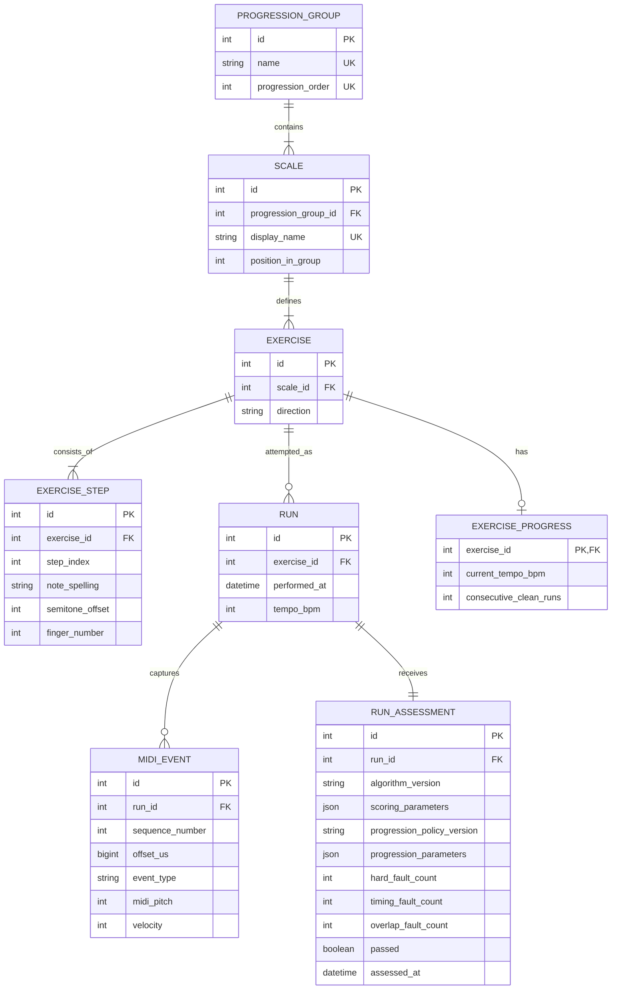

# Candidate 1: Normalized Catalog With Versioned Assessments

## Summary

This model uses normalized relational tables for exercise definitions, raw MIDI
activity, scoring, and progression. It offers the best balance of simplicity,
defensible schema design, useful migrations, and domain-focused tests.

This is the selected model for v1.

## ORM Diagram

## Tables

### `progression_groups`

The three fingering groups and their progression order.

### `scales`

The twelve physical scales, including their progression group and position.
F-sharp/G-flat is represented by one row because it is one physical exercise.

### `exercises`

One row for each scale and direction. The twelve scales therefore produce 24
exercises, each with independent tempo progression.

### `exercise_steps`

Eight ordered steps per exercise. Each step contains:

- its position in the exercise
- its displayed note spelling
- its semitone offset from the starting note
- its right-hand finger number

Relative semitone offsets allow an exercise to begin in any octave. The first
valid note anchors the register, after which exact MIDI pitches can be derived.

### `runs`

One row per completed attempt, containing the exercise, performance date, and
tempo.

There is no capture status. The application holds an in-progress attempt in
memory and persists the run, its events, its original assessment, and its
progress update in one transaction when the attempt finishes. Losing an
interrupted attempt is acceptable for this single-user hobby project.

### `midi_events`

One row per normalized note-on or note-off message. Each event contains its run,
sequence number, signed microsecond offset from the first expected note, MIDI
pitch, and velocity.

### `run_assessments`

One persisted row per run. It records the original decision made when the run
occurred, including the scoring algorithm version, threshold parameters,
recovery-window size, aggregate fault counts, timing statistics, overlap
statistics, and pass/fail result.

It also records the progression policy version and parameters needed to replay
the effect of the assessment on progression. This includes values such as the
clean-run target, tempo increment, and eventual failed-run behavior.

A current assessment is not persisted. When a historical run is read, the
application scores its immutable MIDI events with the active algorithm and
returns that result alongside the stored original assessment. This lazy
calculation avoids a batch re-scoring job and avoids database writes during a
read. The dataset is small enough that repeated calculation is acceptable.

### `exercise_progress`

The current tempo and consecutive-clean-run count for each exercise. It is a
reconstructable snapshot that should be updated transactionally when an
original run assessment affects progression.

The application must provide a rebuild operation that resets one exercise's
snapshot and replays its original assessments in deterministic run order using
their recorded progression policy versions and parameters. A domain test must
apply a representative sequence of assessments through the normal update path,
rebuild the snapshot, and assert that both results are identical.

## Octave Anchoring

The expected tonic pitch class is known before a run begins, but its octave is
not. The analyzer therefore behaves as follows:

1. If a played note has the wrong pitch class for step 1, record a hard fault
   against step 1 and leave the expected-step cursor at step 1.
2. Continue waiting until the expected tonic pitch class is played.
3. Use that first correct note's full MIDI pitch to anchor the exercise octave.
4. Derive every subsequent expected MIDI pitch from that anchor and the stored
   semitone offsets.

For example, a C exercise continues waiting for a C after any initial wrong
notes. The anchoring note does not move the timing grid: event offsets remain
relative to the predetermined first expected beat. Normal recovery-window rules
apply after initial hard faults.

## Invariants

- Raw MIDI events are immutable source data.
- Event ordering uses a sequence number because timestamps may be equal.
- Each exercise has exactly eight ordered steps.
- Every persisted run is complete and has exactly one original assessment.
- The first expected note has offset zero; later expected times follow one note
  per metronome beat.
- Wrong pitch classes before anchoring are hard faults against step 1 and do not
  advance the expected-step cursor.
- The first correct tonic anchors the octave. Subsequent wrong-octave notes are
  hard faults.
- Ascending and descending exercises progress independently.
- Stored original assessments drive progression; current assessments are
  calculated lazily for updated reporting and comparison.
- Scoring parameters are recorded with each assessment so historical outcomes
  remain reproducible.
- The stored progression snapshot must equal a rebuild from original
  assessments.

## Trade-offs

This model has more tables and joins than a compact document-oriented design.
In return, each table has one clear responsibility, important domain rules can
be enforced by database constraints, and the schema provides meaningful
examples of relational modeling and migrations.

It intentionally derives per-step results from raw events instead of storing
them. Materialized results can be added later if reporting or performance
creates a concrete need.
