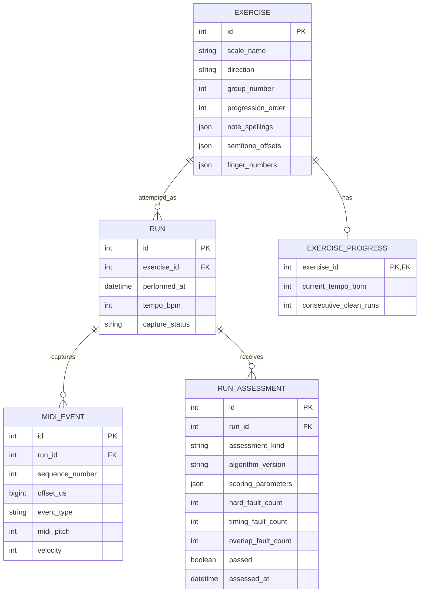

# Candidate 2: Compact Hybrid Model

## Summary

This model keeps each complete exercise definition in one seeded database row.
The ordered note spellings, semitone offsets, and fingering are stored as
structured JSON or database arrays rather than normalized step rows.

It minimizes schema size while retaining raw MIDI events and reproducible,
versioned scoring.

## ORM Diagram

## Tables

### `exercises`

One row for each scale and direction. Group, scale identity, display name,
progression order, and direction are ordinary fields. The eight note spellings,
relative semitone offsets, and finger numbers are stored as structured values.

F-sharp/G-flat remains one physical scale. Ascending and descending remain
separate exercises.

### `runs`

One row per attempt, containing the exercise, performance date, tempo, and
capture status.

### `midi_events`

One row per normalized note-on or note-off message. Events use an explicit
sequence number and a signed microsecond offset from the first expected note.

### `run_assessments`

Versioned scoring results containing the algorithm version, complete scoring
parameters, aggregate statistics, and pass/fail outcome. Original and current
assessments are retained separately.

### `exercise_progress`

The current tempo and consecutive-clean-run count for each independently
progressing scale-direction exercise.

## Invariants

- Each exercise definition must contain eight aligned note, offset, and finger
  values.
- Relative semitone offsets allow the first valid note to anchor any octave.
- Raw MIDI events remain immutable.
- Event sequence numbers define deterministic ordering.
- Original assessments drive progression; current assessments show the latest
  interpretation.
- One expected note occurs per metronome beat.

Most exercise-definition invariants must be enforced by application-level
validation and tests because ordinary relational constraints cannot easily
validate aligned JSON arrays.

## Advantages

- It has the smallest schema of the three candidates.
- A complete exercise can be loaded without joining step rows.
- Seed data remains the database source of record.
- Raw events still permit future re-analysis.

## Disadvantages

- The database cannot easily enforce exactly eight correctly ordered steps.
- Fingering and pitch-shape constraints move into application tests.
- Cross-scale questions, such as comparing every step played with finger 4,
  require awkward JSON queries.
- Changes inside structured exercise data make less instructive migration
  examples.

This model fits if minimizing schema size is more important than demonstrating
relational domain modeling.
