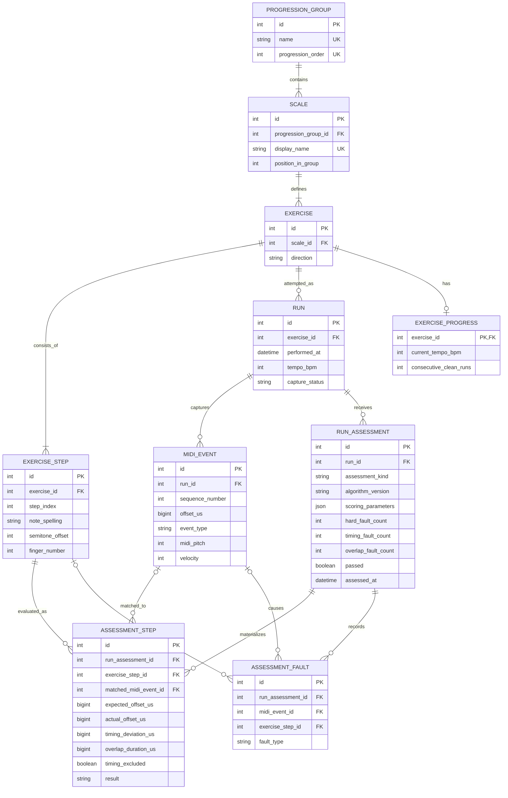

# Candidate 3: Normalized Model With Materialized Step Analysis

## Summary

This model starts with the normalized catalog, raw MIDI event, assessment, and
progression tables from Candidate 1. It additionally stores the versioned
per-step interpretation produced by the scoring algorithm.

Raw MIDI events remain the source of truth. Materialized analysis rows are
replaceable derived data associated with a particular scoring version.

## ORM Diagram

## Core Tables

The core consists of:

- `progression_groups`
- `scales`
- `exercises`
- `exercise_steps`
- `runs`
- `midi_events`
- `run_assessments`
- `exercise_progress`

Their responsibilities and invariants are the same as in Candidate 1.

## Additional Tables

### `assessment_steps`

One row for each expected exercise step under a particular run assessment. It
can record:

- the expected step
- the matched MIDI note-on event, if any
- expected and actual timing offsets
- timing deviation
- overlap duration or overlap status
- whether timing was excluded by the post-fault recovery window
- whether the expected note was missed or played incorrectly

These are analysis rows, not replacements for raw MIDI events.

### `assessment_faults`

One row for each hard fault or other result that does not map cleanly to one
expected step. Examples include extra notes, duplicate notes, and glancing an
adjacent key. A fault may reference a MIDI event, an expected step, both, or
neither when appropriate.

## Invariants

- Every materialized analysis row belongs to one versioned run assessment.
- Re-scoring creates a new assessment and a new set of derived rows; it does not
  overwrite the original assessment.
- Raw MIDI events are immutable and sufficient to reconstruct all analysis.
- Each assessment has at most one result for each expected exercise step.
- Event sequence numbers, not timestamps alone, determine event order.
- Original assessments drive progression; later assessments do not rewrite
  historical advancement decisions.
- The first valid note anchors the octave, and expected pitches are derived from
  exercise-step semitone offsets.

## Advantages

- Per-scale, per-direction, and per-step reporting is direct and efficient.
- Matching and scoring decisions are inspectable rather than hidden inside
  aggregate values.
- Domain tests can assert exact step matching, recovery exclusions, timing
  deviations, and overlap results.
- Results from different scoring versions can be compared without repeatedly
  analyzing the raw event stream.

## Disadvantages

- It stores information that can be derived from the raw events.
- Re-analysis must create and maintain a complete, internally consistent result
  set.
- Event-to-step matching introduces substantially more schema and application
  complexity.
- It solves reporting and performance needs that have not yet been observed.

This is a strong possible evolution after v1, but it is premature as the
initial model unless inspecting and querying per-step scoring decisions is a
primary portfolio goal.
