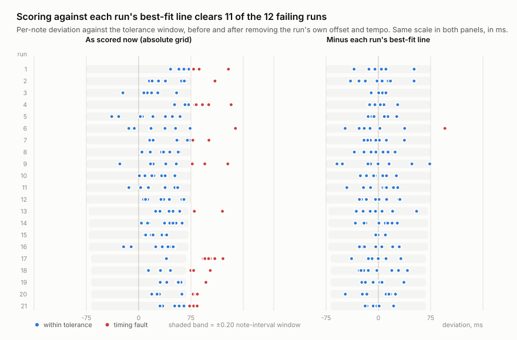
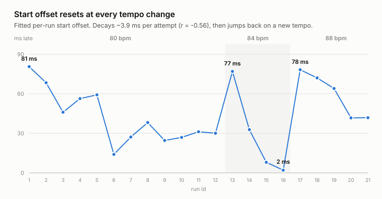
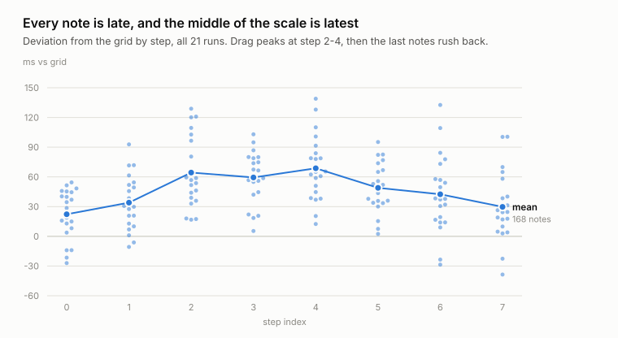
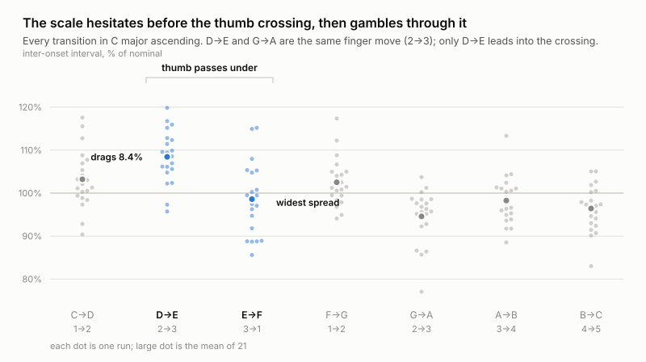

# Report 001 — Timing offset in the C major ascending session

- **Date of analysis:** 2026-08-07
- **Data:** `data/` — `runs.csv`, `midi-events.csv`, `exercise-steps.csv` (runs 1–21, exported from `piano.db`)
- **Session recorded:** 2026-08-06 04:10:52 – 04:14:52 UTC (~4 minutes, continuous)

## Summary

All 21 runs sit systematically late against the metronome grid by a mean of
**+46.2 ms** (median +44.6 ms). Decomposing each run into a start offset, a
tempo error and a residual shows the lateness is almost entirely a **constant
per-run shift**, not drift and not unevenness: fitted tempo error averages
**0.20 %**, i.e. once a run starts, the grid is held nearly perfectly.

Because the scorer measures every note against an absolute grid anchored at
`firstExpectedBeat`, that shift is charged to all 8 notes of a run. It accounts
for roughly half of all failed runs.

The offset is **not** a fixed constant. It decays ~3.9 ms per attempt within a
tempo block and resets to ~78–81 ms every time the tempo changes — which rules
out pure hardware latency as the sole cause.

What remains after the offset is removed is not noise either. It is the **thumb
crossing**: the player drags 8.4 % on the way into it and then snatches through
it with the widest spread of any transition, and 23 of the 35 faulted notes sit
on the three notes spanning it. A paired control (t(20) = 6.68, holding in 19 of
21 runs) separates this from a general early-drag/late-rush shape.

## Dataset

| Property | Value |
|---|---|
| Runs | 21 |
| Exercise | C major, ascending (all runs) |
| Grid | eighth notes (`notes_per_beat = 2`) |
| Tempo blocks | 80 bpm ×12, 84 bpm ×4, 88 bpm ×5 |
| Note onsets | 168 (8 per run) |
| MIDI events | 336 |
| Hard faults | **0** across all runs |
| Overlap faults | 6 in every run (constant; does not gate) |

Zero hard faults across the whole session — no wrong pitches, no missed notes,
no extra notes. Every failure in this dataset is a timing failure.

## Method

`midi_events.offset_us` is measured relative to `firstExpectedBeat`, an absolute
metronome anchor sharing the DOM performance time origin
(`src/client/midi/capture.ts:36`). Deviation for step *i* is therefore
`offset_us − round(i × noteIntervalUs)`, matching `scoreRun` in
`src/domain/scoring.ts`.

Each run's 8 onsets were fit with least-squares linear regression against step
index, yielding:

- **intercept** — start offset in ms (the "latency" term)
- **slope** — realised note interval; compared to nominal to give tempo error %
- **residual RMS** — spread around the player's own line, i.e. true unevenness

**Validation:** mean absolute deviation recomputed from raw events matches the
stored `run_assessments.mean_absolute_timing_deviation_us` for **21/21 runs**
(tolerance 0.6 ms), confirming the pipeline reproduces the app's own scoring.

## Decomposition

| Component | Mean | Interpretation |
|---|---|---|
| Intercept | **43.8 ms** | constant start lag — the "~45 ms" |
| Tempo (slope) error | **0.20 %** | tempo accuracy vs the click |
| Residual RMS | **20.9 ms** | actual note-to-note unevenness |

A tempo error of 0.20 % is negligible. The player is not dragging or rushing
across a run; the entire run is translated late.

## Per-run detail

`mad` = mean absolute deviation as stored by the app. `faults −45` = timing
faults remaining after subtracting a flat 45 ms. `faults −fit` = timing faults
remaining after subtracting that run's own mean offset. Tolerance is
±0.20 × note interval (75.0 ms at 80 bpm, 71.4 ms at 84, 68.2 ms at 88);
`maxTimingFaultsPerRun` is 0, so one bad note fails a run.

| run | bpm | mad (ms) | intercept (ms) | tempo err % | resid RMS (ms) | faults | faults −45 | faults −fit | passed |
|---|---|---|---|---|---|---|---|---|---|
| 1 | 80 | 75.2 | 80.6 | -0.4 | 23.1 | 3 | 1 | 0 | no |
| 2 | 80 | 50.7 | 68.4 | -1.4 | 27.1 | 1 | 0 | 0 | no |
| 3 | 80 | 23.0 | 46.0 | -2.6 | 7.8 | 0 | 0 | 0 | yes |
| 4 | 80 | 84.7 | 56.4 | 2.2 | 13.6 | 5 | 1 | 0 | no |
| 5 | 80 | 30.2 | 59.2 | -3.5 | 13.5 | 0 | 1 | 0 | yes |
| 6 | 80 | 44.8 | 14.0 | 2.0 | 43.2 | 1 | 1 | 1 | no |
| 7 | 80 | 58.8 | 27.2 | 2.4 | 17.1 | 2 | 0 | 0 | no |
| 8 | 80 | 31.7 | 38.2 | -0.5 | 19.8 | 0 | 0 | 0 | yes |
| 9 | 80 | 57.2 | 24.6 | 2.0 | 42.6 | 3 | 1 | 2 | no |
| 10 | 80 | 26.4 | 26.9 | -0.0 | 15.7 | 0 | 0 | 0 | yes |
| 11 | 80 | 31.2 | 31.2 | -0.3 | 22.8 | 0 | 0 | 0 | yes |
| 12 | 80 | 33.6 | 30.1 | 0.3 | 21.1 | 0 | 0 | 0 | yes |
| 13 | 84 | 56.5 | 77.0 | -1.6 | 25.5 | 2 | 1 | 0 | no |
| 14 | 84 | 34.9 | 32.8 | 0.2 | 20.1 | 0 | 0 | 0 | yes |
| 15 | 84 | 25.9 | 8.0 | 1.4 | 4.1 | 0 | 0 | 0 | yes |
| 16 | 84 | 34.9 | 2.1 | 2.0 | 20.6 | 0 | 0 | 0 | yes |
| 17 | 88 | 96.4 | 78.3 | 1.5 | 19.7 | 7 | 1 | 0 | no |
| 18 | 88 | 52.7 | 72.1 | -1.6 | 24.9 | 3 | 0 | 0 | no |
| 19 | 88 | 56.8 | 64.0 | -0.6 | 17.2 | 1 | 0 | 0 | no |
| 20 | 88 | 57.7 | 41.7 | 1.3 | 24.1 | 4 | 0 | 0 | no |
| 21 | 88 | 59.5 | 41.9 | 1.5 | 14.3 | 3 | 0 | 0 | no |

## Impact on pass rate

Runs with zero timing faults, and total faulted notes out of 168, under
different offset-compensation models:

| Model | What it removes | Passing runs | Faulted notes |
|---|---|---|---|
| As currently scored | nothing | **9 / 21** | 35 |
| Anchored to note 0 | note 0's own error | 10 / 21 | 19 |
| Minus a flat 45 ms | a fixed constant | **14 / 21** | 7 |
| Minus each run's mean offset | that run's constant | **19 / 21** | 3 |
| Minus each run's best-fit line | offset **and** tempo | **20 / 21** | 1 |

<picture>
  <source media="(prefers-color-scheme: dark)" srcset="charts/before-after-correction-dark.svg">
  
</picture>

Roughly half the failures in this session are attributable to the offset rather
than to playing quality. Anchoring to note 0 performs poorly because note 0
carries its own error; a best-fit line is the better reference.

The last row is the strongest correction because it removes the tempo term as
well as the offset — worth separating from the mean-offset row, since 0.20 %
mean tempo error is already negligible and buys only one extra run. Almost all
of the gain (9 → 19) is the constant offset alone.

The single note that still faults after correction is in run 6, which has the
worst residual RMS in the session at 43.2 ms. That one is genuinely uneven
playing, which is exactly what the metric should be catching.

## The offset is not constant

Intercept by position within each tempo block, first attempt → last:

- **80 bpm:** 81 → 68 → 46 → 56 → 59 → 14 → 27 → 38 → 25 → 27 → 31 → 30
- **84 bpm:** 77 → 33 → 8 → 2
- **88 bpm:** 78 → 72 → 64 → 42 → 42

Regressed against position-in-block: **-3.9 ms per attempt, r = -0.56**.

<picture>
  <source media="(prefers-color-scheme: dark)" srcset="charts/offset-per-attempt-dark.svg">
  
</picture>

Every block restarts high (81, 77, 78 ms) and decays over 3–5 attempts. Fixed
device latency cannot produce a reset on tempo change. The 84 bpm block settles
to 2 ms, showing no hardware floor is being hit there.

**Caveat:** this measurement bundles MIDI device/driver latency, metronome click
output latency, and human reaction lag into a single number. They cannot be
separated from this dataset alone. The reset-on-tempo-change pattern proves a
substantial share is human adaptation, so calibrating out a flat 45 ms would
overcorrect settled runs — see run 5, which passes now but gains a fault under
flat −45 ms compensation.

## Within-run shape

Mean inter-onset interval as a percentage of nominal:

| transition | % of nominal | |
|---|---|---|
| 0 → 1 | 103.2 % | drag 3.2 % |
| 1 → 2 | 108.4 % | drag 8.4 % |
| 2 → 3 | 98.6 % | rush 1.4 % |
| 3 → 4 | 102.5 % | drag 2.5 % |
| 4 → 5 | 94.6 % | rush 5.4 % |
| 5 → 6 | 98.3 % | rush 1.7 % |
| 6 → 7 | 96.4 % | rush 3.6 % |

An arch: drag into note 2, then rush through the back half. This is the main
structure remaining once the offset is removed — and the next section shows it
is not an arch at all, but the thumb crossing.

<picture>
  <source media="(prefers-color-scheme: dark)" srcset="charts/step-profile-dark.svg">
  
</picture>

Deviation from the grid by step index, across all 21 runs — the values behind
the mean line above:

| step | mean (ms) | sd (ms) | min | max |
|---|---|---|---|---|
| 0 | 22.3 | 24.8 | -27 | 54 |
| 1 | 34.0 | 26.8 | -11 | 93 |
| 2 | **64.4** | 34.8 | 17 | 129 |
| 3 | 59.4 | 25.6 | 5 | 103 |
| 4 | **68.7** | 32.1 | 12 | 139 |
| 5 | 49.0 | 24.6 | 2 | 95 |
| 6 | 42.5 | 38.3 | -29 | 133 |
| 7 | 29.7 | 33.9 | -39 | 101 |

Note that step 0 is the *least* late note at 22.3 ms, well under the 43.8 ms
mean intercept. The first note lands closer to the click than the fitted line
predicts — consistent with starting deliberately and then settling into a lag.

Residual RMS across the 21 attempts in order:
`23 27 8 14 14 43 17 20 43 16 23 21 26 20 4 21 20 25 17 24 14`
— first 11 mean 22.4 ms, last 10 mean 19.2 ms. Essentially flat; four minutes
is too short to show unevenness improving.

## The thumb crossing explains the arch

The fingering was in the schema the whole time (`exercise_steps.finger_number`,
exported to `data/exercise-steps.csv`) and the first pass ignored it, treating
the scale as eight anonymous slots. It is not: C major ascending is fingered
**1-2-3-1-2-3-4-5**, and the finger number *falls* between step 2 and step 3 —
the thumb passing under the hand on E→F. That is the one genuine technical
event in the exercise, and it dominates the timing.

Measured as inter-onset interval, which is local and so does not carry the
run's accumulated offset into every later note:

| transition | fingers | IOI % of nominal | sd | |
|---|---|---|---|---|
| C→D | 1→2 | 103.2 | 6.6 | |
| **D→E** | **2→3** | **108.4** | 6.0 | approach to the crossing |
| **E→F** | **3→1** | **98.6** | **8.1** | **the crossing** |
| F→G | 1→2 | 102.5 | 5.4 | |
| G→A | 2→3 | 94.6 | 6.0 | |
| A→B | 3→4 | 98.3 | 5.4 | |
| B→C | 4→5 | 96.4 | 5.2 | |

<picture>
  <source media="(prefers-color-scheme: dark)" srcset="charts/crossing-by-transition-dark.svg">
  
</picture>

Two different things happen, and conflating them would be a mistake:

- **The approach drags, reliably.** D→E runs 8.4 % long with a moderate spread.
  The player hesitates on the way into the crossing nearly every time.
- **The crossing itself is not slow — it is erratic.** E→F averages 98.6 %,
  marginally *rushed*, but carries the widest spread of any transition at
  sd 8.1. The tuck is not consistently dragged; it is snatched, by a varying
  amount. Hesitate reliably, then gamble.

### The control

D→E sits early in the run and G→A late, so a general "drag early, rush late"
shape could produce this without any crossing involved. C→D and F→G are the
same comparison with no crossing between them, which separates the two
explanations:

| pair | fingers | gap | t(20) |
|---|---|---|---|
| C→D vs F→G | 1→2 | 0.7 pts | 0.34 — nothing |
| **D→E vs G→A** | **2→3** | **13.9 pts** | **6.68** |

Both pairs are the same finger move separated by the same distance in the
sequence. If position drove the effect, both gaps would be alike. One is
indistinguishable from zero and the other is 13.9 percentage points, holding in
**19 of 21 runs**. The crossing is the only structural difference.

### Two-thirds of the faults are in the crossing region

| steps | notes (fingers) | faulted notes |
|---|---|---|
| 0–1 | C(1), D(2) | 1 |
| **2–4** | **E(3), F(1), G(2)** | **23** |
| 5–7 | A(3), B(4), C(5) | 11 |

23 of 35 timing faults land on the three notes spanning the crossing.

### Two hypotheses this rules out

- **Weak fingers are not the problem.** The intuitive guess — that 4 and 5 are
  weak, so A→B and B→C should be worst — is wrong. They are the two *most*
  consistent transitions in the set (sd 5.4 and 5.2, the lowest of the seven).
- **It is not being practised away.** The D→E drag shows no trend across
  attempts (115, 113, 97, 102, 106, 106, 110, 107, 105, 109, 96, 110 at 80 bpm).
  Four minutes does not touch it, so it is a stable motor pattern rather than
  warm-up or fatigue. It also *worsens* with tempo — 106 % at 80 bpm, 112 % at
  84, 111 % at 88 — which is what a real bottleneck looks like.

### Limits

One player, one session, one scale, ascending only. The paired control is
strong for this data but does not generalise on its own. E→F is measured
onset-to-onset, so it cannot separate "hesitating before the tuck" from
"holding E too long" — the `note_off` events in `data/midi-events.csv` would
settle that, which is the same open question as the overlap recommendation
below. Descending
runs would be the real test, since the crossing reverses to finger 1 passing
*over*.

## Recommendations

1. **Score against a best-fit line rather than the absolute grid.** Takes
   passing runs from 9 to 20 and faulted notes from 35 to 1, while still
   measuring evenness, which is the quantity of interest. Highest-value change
   in this report. Note this changes what "passing" means, so stored
   assessments would need re-scoring to stay comparable.
2. **Do not hard-code a 45 ms latency constant.** The offset is partly human and
   partly tempo-dependent; a flat correction overcorrects settled runs.
3. **Report start offset separately** from unevenness in the end-of-round table.
   They are independent skills and currently collapse into one number.
4. **Make the feedback fingering-aware.** The end-of-round table treats all
   eight notes alike, but the faults are not spread evenly — two-thirds sit on
   the crossing. Naming it ("you hesitate going into the thumb crossing")
   is far more actionable than a per-note deviation column, and the data
   needed is already stored. A "crossing cost" metric — the gap between the
   two occurrences of the same finger move — is one number that captures the
   session's dominant flaw.
5. **Practise the approach, not the crossing.** The drag is on D→E, the note
   *before* the tuck; the tuck itself is merely inconsistent. That distinction
   is worth surfacing, because practising the crossing in isolation targets the
   wrong beat.
6. **Investigate the constant 6 overlap faults per run.** Identical across all
   21 runs regardless of tempo or quality — suspicious for a real measurement.
   Note overlap does not currently gate pass/fail.
7. **Capture a reference run with known device latency** before attempting any
   true hardware calibration.

## Data and reproduction

Everything this report rests on lives in this directory:

```
reports/001-midi-latency/
  REPORT.md                  this document
  charts/*.svg               8 files: 4 figures x light/dark
  data/runs.csv              21 rows -- conditions + the assessment the app stored
  data/midi-events.csv       336 rows -- every captured MIDI event
  data/exercise-steps.csv    8 rows -- the notes and the fingering
```

`piano.db` is **not** the record of this session — it is gitignored (`*.db`), so
it would not survive a fresh clone. The CSVs are the durable copy, and they are
a lossless export: all 336 events and 21 runs match the database field for
field. Every number and figure here can be rebuilt from them alone.

```
npm run report:charts    # CSVs -> charts/*.svg   (no database needed)
npm run report:data      # piano.db -> data/*.csv (only if the session changes)
```

The render step deliberately reads the CSVs rather than the database, so the
figures regenerate on any clone. It prints the headline counts as it runs,
which is the quickest way to re-check this report against its own data.

Three notes on how the figures are built:

- The raw panel of the before/after figure reproduces the app's own scoring
  exactly — 35 faulted notes and 9 clean runs, matching the stored
  `run_assessments` row for row (kept in `data/runs.csv` so that stays
  checkable). The figures are not an independent re-implementation with its own
  drift.
- `data/midi-events.csv` includes `note_off` events, which the timing analysis
  does not use. They are there so the open overlap-fault question in
  the overlap recommendation can be investigated later without the original
  database.
- The figures are static SVG, so there is no hover layer. Every plotted value is
  therefore also present in a table in this document: per-run values in
  *Per-run detail*, per-step values in *Within-run shape*. Nothing is readable
  only from a chart.
